# Calculadora de Cinemática 1D e 2D

Calculadora de cinemática com **solver automático**: você informa só o que tem (em qualquer unidade) e o programa encontra sozinho as fórmulas necessárias até chegar no valor pedido, mostrando o passo a passo. Inclui animações da trajetória e gráficos interativos.

> Trabalho da disciplina **Física Geral e Experimental**.

## Funcionalidades

- **Movimentos:** MRU, MRUV, queda livre e lançamento de projétil (horizontal e oblíquo).
- **Unidade por campo:** cada entrada tem seu seletor (m, cm, km · s, ms, min, h · m/s, km/h · m/s² · graus, rad).
- **Conversão automática:** tudo é convertido para o SI antes do cálculo e o resultado volta na unidade escolhida.
- **Solver:** encadeia as fórmulas até achar a incógnita; se faltar dado, diz exatamente o que falta.
- **Passo a passo** com fórmulas renderizadas em KaTeX.
- **Três temas visuais:**
  1. **Laboratório de Lançamentos**: plano cartesiano (estilo GeoGebra) com trajetória, vetores vₓ e v_y e controle de tempo.
  2. **Pista de Frenagem**: carro animado com gráficos s × t e v × t.
  3. **Torre de Queda Livre**: prédio com régua e marcações a cada 0,5 s.

## Tecnologias

| Camada       | Tecnologia                                        |
| ------------ | ------------------------------------------------- |
| Backend      | Python 3.12+ · FastAPI · Pydantic                 |
| Frontend     | React · Vite · Tailwind CSS                       |
| Gráficos     | Mafs (plano cartesiano) · Recharts (s × t, v × t) |
| Fórmulas     | KaTeX                                             |
| Testes       | pytest                                            |
| Diagrama UML | pyreverse (pylint) · Mermaid                      |

## Estrutura

```
cinematica/
├── package.json            # scripts que sobem back + front juntos
├── backend/
│   ├── requirements.txt
│   ├── fisica/             # núcleo puro (sem FastAPI): tudo em SI
│   │   ├── unidades.py     # Dimensao, Unidade, Grandeza, Conversor
│   │   ├── formulas.py     # Formula (interface), FormulaBase (abstrata), fórmulas 1D e 2D
│   │   ├── movimentos.py   # Movimento (abstrata), MRU, MRUV, QuedaLivre, LancamentoProjetil
│   │   └── solver.py       # Solver, Resultado, DadosInsuficientes
│   ├── app/
│   │   ├── main.py         # POST /api/calcular, erros 400 e serve o frontend compilado
│   │   └── schemas.py      # modelos Pydantic (contrato com o React)
│   ├── docs/uml/           # diagramas de classes (Mermaid)
│   └── tests/              # pytest: unidades, fórmulas, solver, projétil, trajetória, API
└── frontend/
    ├── vite.config.js      # proxy /api -> localhost:8000
    └── src/
        ├── api.js
        ├── componentes/    # CampoUnidade, CartaoResultado, ControleTempo, PassoAPasso
        ├── temas/          # Lancamentos, Frenagem, QuedaLivre
        └── App.jsx
```

## Pré-requisitos

- [Python 3.12+](https://www.python.org/downloads/)
- [Node.js 20+](https://nodejs.org/) (só para desenvolvimento)
- Git

## Como rodar (desenvolvimento)

```bash
# 1. Clonar
git clone https://github.com/SEU_USUARIO/cinematica.git
cd cinematica

# 2. Backend
cd backend
python -m venv .venv
# Windows:      .\.venv\Scripts\Activate.ps1
# Linux/macOS:  source .venv/bin/activate
pip install -r requirements.txt
cd ..

# 3. Frontend
npm install
npm --prefix frontend install

# 4. Subir tudo (com a .venv ativada)
npm run dev
```

- Frontend: http://localhost:5173
- API e documentação interativa: http://localhost:8000/docs

Em desenvolvimento, o Vite repassa tudo que começa com `/api` para a porta 8000, sem problemas de CORS.

## Como rodar (entrega / só com Python)

```bash
npm run build   # gera frontend/dist
npm start       # FastAPI serve a API e o site em http://localhost:8000 (com a .venv ativada)
```

Se o `frontend/dist` já estiver pronto, basta o Python:

```bash
cd backend
python -m uvicorn app.main:app --port 8000
```

## Testes

```bash
npm test
# ou: cd backend && pytest
```

Os testes conferem os três exemplos de demonstração e o caso de erro (`tests/test_exemplos.py`):

| Caso               | Entrada                                 | Resultado esperado                             |
| ------------------ | --------------------------------------- | ---------------------------------------------- |
| Lançamento oblíquo | 20 m/s a 35°, do chão                   | t_voo = 2,34 s · alcance = 38,3 m · H = 6,71 m |
| Frenagem           | 72 km/h, a = −4 m/s²                    | para em 5 s, após 50 m                         |
| Queda livre        | solta de 4500 cm                        | 3,03 s · 29,7 m/s (107 km/h)                   |
| Erro               | só altura → v₀ de lançamento horizontal | "falta o alcance horizontal"                   |

Além deles: cada isolamento de cada fórmula, conversões de unidade, o comportamento do solver, a trajetória e a API (sucesso, erros 400 e 422).

## API

O frontend usa uma única rota: **`POST /api/calcular`**. O contrato completo (com todos os modelos) fica em `/docs`.

### Variáveis aceitas

| `movimento`   | variáveis (`id`)                                                    | padrões             |
| ------------- | ------------------------------------------------------------------- | ------------------- |
| `mru`         | `ds`, `v`, `t`                                                      | —                   |
| `mruv`        | `ds`, `v0`, `v`, `a`, `t`                                           | —                   |
| `queda_livre` | `h`, `v0`, `v`, `g`, `t`                                            | v0 = 0 · g = 9,81   |
| `projetil`    | `v0`, `theta`, `h0`, `g`, `A`, `H`, `t_voo`, `vx`, `vy`             | h0 = 0 · g = 9,81   |

Unidades (`id`): `m` `cm` `km` · `s` `ms` `min` `h` · `m/s` `km/h` · `m/s2` · `grau` `rad`.
Lançamento horizontal = `projetil` com `theta` = 0.

### Exemplo (Pista de Frenagem)

```json
POST /api/calcular
{
  "movimento": "mruv",
  "conhecidas": {
    "v0": {"valor": 72, "unidade": "km/h"},
    "v":  {"valor": 0,  "unidade": "m/s"},
    "a":  {"valor": -4, "unidade": "m/s2"}
  },
  "alvo": "ds",
  "unidade_alvo": "m"
}
```

Resposta `200` (resumida):

```json
{
  "resultado": {"valor": 50.0, "unidade": "m", "valor_si": 50.0, "unidade_si": "m",
                "conversoes": {"m": 50.0, "cm": 5000.0, "km": 0.05}},
  "passos": [
    {"formula": "Função horária da velocidade", "latex_isolada": "t = \\frac{v - v_0}{a}", "variavel": "t", "valor_si": 5.0, "...": "..."},
    {"formula": "Função horária da posição", "variavel": "ds", "valor_si": 50.0, "...": "..."}
  ],
  "estado": {"v0": 20.0, "v": 0.0, "a": -4.0, "t": 5.0, "ds": 50.0},
  "trajetoria": [{"t": 0.0, "s": 0.0, "v": 20.0}, "...", {"t": 5.0, "s": 50.0, "v": 0.0}]
}
```

- `conversoes`: o resultado em todas as unidades da mesma dimensão (para trocar a unidade sem nova chamada).
- `estado`: tudo o que foi possível calcular, em SI.
- `trajetoria`: 61 pontos de t = 0 até o fim do movimento. Chaves: `t, s, v` (MRU/MRUV) · `t, y, v` (queda livre, y = altura até o chão) · `t, x, y, vx, vy` (projétil).

### Erros

| Status | `tipo`                 | Quando                                                        |
| ------ | ---------------------- | ------------------------------------------------------------- |
| 400    | `dados_insuficientes`  | faltam dados; `faltando` lista o que destravaria o cálculo    |
| 400    | `dados_inconsistentes` | a conta é impossível (ex.: o carro para antes da distância)   |
| 400    | `entrada_invalida`     | unidade inexistente, dimensão errada, variável inexistente    |
| 422    | —                      | JSON fora do formato (validação automática do Pydantic)       |

```json
{
  "tipo": "dados_insuficientes",
  "mensagem": "Não foi possível calcular velocidade inicial (v0). Informe também: alcance horizontal (A) ou velocidade horizontal (vx).",
  "faltando": [{"id": "A", "nome": "alcance horizontal"}, {"id": "vx", "nome": "velocidade horizontal"}]
}
```

## Arquitetura do núcleo

- **Unidade / Grandeza:** cada unidade guarda o fator para o SI; a grandeza é valor + unidade.
- **Conversor:** converte qualquer grandeza para o SI e de volta, e recusa unidade de dimensão errada.
- **Formula** (interface) → **FormulaBase** (abstrata): a parte comum (contar incógnitas, montar o passo a passo em LaTeX, tratar divisão por zero); cada equação concreta só implementa `_isolar`.
  Os *papéis* permitem reaproveitar uma equação com outros nomes: a queda livre usa as fórmulas do MRUV com `a → g` e `Δs → h`.
- **Movimento** (abstrata) → `MRU`, `MRUV`, `QuedaLivre`, `LancamentoProjetil`: cada um declara suas variáveis, fórmulas, valores padrão e a trajetória.
  O `LancamentoProjetil` sobrescreve o gancho `preparar()` para o lançamento horizontal (θ = 0 ⇒ v_y = 0).
- **Solver:** enquanto houver fórmula com exatamente uma incógnita, resolve e continua até achar o alvo, registrando cada passo. Se travar, testa quais variáveis, informadas a mais, destravariam o alvo e devolve essa lista na mensagem de erro.

## Diagrama de classes

Gerado com `pyreverse` a partir do código e revisado à mão (estereótipos de interface/abstrata, métodos abstratos protegidos, composições e exceções).
Fontes em [`backend/docs/uml/`](backend/docs/uml/): `classes_cinematica.mmd` (gerado) e `classes_revisado.mmd` (revisado, abaixo).

```mermaid
classDiagram
  direction TB

  class Formula {
    <<interface>>
    +variaveis frozenset
    +incognita_isolavel(conhecidas)* str
    +calcular(alvo, conhecidas)* float
  }
  class FormulaBase {
    <<abstract>>
    +nome str
    +papeis tuple
    +latex str
    +isoladas dict
    +incognitas(conhecidas) frozenset
    +incognita_isolavel(conhecidas) str
    +calcular(alvo, conhecidas) float
    +passo(alvo, conhecidas, valor, simbolos) Passo
    #_isolar(papel, x)* float
    #_observacao(papel) str
  }
  class MovimentoUniforme
  class VelocidadeTempo
  class EquacaoHoraria
  class Torricelli {
    #_observacao(papel) str
  }
  class VelocidadeMedia
  class ComponenteX {
    +incognita_isolavel(conhecidas) str
  }
  class ComponenteY {
    +incognita_isolavel(conhecidas) str
  }
  class TempoVoo
  class Alcance
  class AlturaMaxima {
    #_observacao(papel) str
  }
  class AnguloPeloAlcance {
    +incognita_isolavel(conhecidas) str
    #_observacao(papel) str
  }
  class Passo {
    <<dataclass>>
    +formula str
    +latex str
    +latex_isolada str
    +variavel str
    +valor_si float
    +usadas dict
    +observacao str
  }

  FormulaBase ..|> Formula
  MovimentoUniforme --|> FormulaBase
  VelocidadeTempo --|> FormulaBase
  EquacaoHoraria --|> FormulaBase
  Torricelli --|> FormulaBase
  VelocidadeMedia --|> FormulaBase
  ComponenteX --|> FormulaBase
  ComponenteY --|> FormulaBase
  TempoVoo --|> FormulaBase
  Alcance --|> FormulaBase
  AlturaMaxima --|> FormulaBase
  AnguloPeloAlcance --|> FormulaBase
  FormulaBase ..> Passo : gera

  class Movimento {
    <<abstract>>
    +nome str
    +variaveis dict
    +formulas list
    +padroes dict
    +preparar(conhecidas) list
    +simbolos() dict
    +trajetoria(estado, n)* list
    #_criar_variaveis()* list
    #_criar_formulas()* list
  }
  class MRU {
    +trajetoria(estado, n) list
  }
  class MRUV {
    +trajetoria(estado, n) list
  }
  class QuedaLivre {
    +padroes dict
    +trajetoria(estado, n) list
  }
  class LancamentoProjetil {
    +padroes dict
    +preparar(conhecidas) list
    +trajetoria(estado, n) list
  }
  class Variavel {
    <<dataclass>>
    +id str
    +nome str
    +simbolo str
    +dimensao Dimensao
    +nao_negativa bool
  }

  MRU --|> Movimento
  MRUV --|> Movimento
  QuedaLivre --|> Movimento
  LancamentoProjetil --|> Movimento
  Movimento "1" *-- "1..*" Formula : formulas
  Movimento "1" *-- "1..*" Variavel : variaveis

  class Solver {
    +resolver(entradas, alvo) Resultado
    -_dar_um_passo(conhecidas, bloqueadas) Passo
    -_alcancaveis(conhecidas) set
    -_o_que_falta(conhecidas, alvo) list
  }
  class Resultado {
    <<dataclass>>
    +alvo str
    +valor_si float
    +passos list
    +estado dict
  }

  Solver o-- Movimento : mov
  Solver ..> Resultado : cria
  Resultado "1" *-- "*" Passo : passos

  class Dimensao {
    <<enumeration>>
    COMPRIMENTO
    TEMPO
    VELOCIDADE
    ACELERACAO
    ANGULO
  }
  class Unidade {
    <<dataclass>>
    +id str
    +simbolo str
    +dimensao Dimensao
    +fator float
  }
  class Grandeza {
    <<dataclass>>
    +valor float
    +unidade Unidade
  }
  class Conversor {
    +buscar(id_unidade)$ Unidade
    +para_si(grandeza)$ float
    +do_si(valor_si, unidade)$ Grandeza
    +unidades_de(dimensao)$ list
    +si_de(dimensao)$ Unidade
    +exigir_dimensao(unidade, dimensao)$ None
  }

  Unidade --> Dimensao
  Variavel --> Dimensao
  Grandeza --> Unidade
  Conversor ..> Grandeza : converte

  class Exception
  class EntradaInvalida
  class DadosInconsistentes
  class DadosInsuficientes {
    +alvo str
    +faltando list
    +nomes dict
  }

  EntradaInvalida --|> Exception
  DadosInconsistentes --|> Exception
  DadosInsuficientes --|> Exception
  Conversor ..> EntradaInvalida : lança
  FormulaBase ..> DadosInconsistentes : lança
  Solver ..> DadosInsuficientes : lança
```



Para regenerar a versão automática:

```bash
cd backend
pyreverse -o mmd -p cinematica -d docs/uml fisica
```

(`-o png` também funciona se o [Graphviz](https://graphviz.org/download/) estiver instalado.)

## Equipe

| Nome   | GitHub |
| ------ | ------ |
| Nome 1 | @      |
| Nome 2 | @      |

## Licença

Projeto acadêmico, uso educacional.
